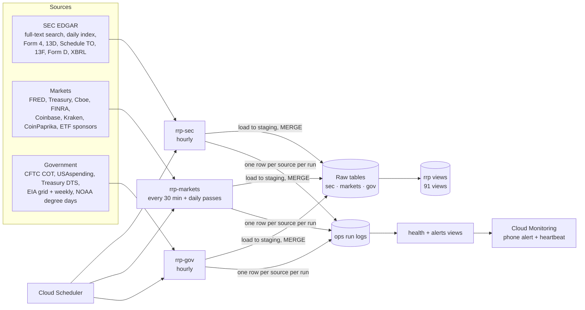

# Financial Data Warehouse on Google Cloud

A personal data-engineering project: a BigQuery warehouse of SEC filings, market data and U.S. government data,
loaded by scheduled Cloud Run jobs and organized into a documented SQL reading layer. It runs unattended around the
clock for a few dollars a month.

**Stack:** Python · BigQuery · Cloud Run jobs · Cloud Scheduler · Cloud Monitoring · Secret Manager · Artifact Registry ·
GitHub Actions (Workload Identity Federation)



## What it loads

| Area | Sources | Examples of what lands in BigQuery |
|---|---|---|
| SEC | EDGAR full-text search (20 streams), EDGAR daily index, Form 4 XML, filing text, XBRL company facts, 13F, Form D, CIK/ticker list | every open-market insider trade line; tender-offer, 13D-stake and redemption terms parsed into columns; delisting filings |
| Markets | FRED, Treasury yields, Cboe, FINRA short volume / short interest, Coinbase, Kraken, CoinPaprika, Farside, SPDR / iShares | macro series from 2000; every U.S.-listed stock and ETF with daily bars; every Coinbase and Kraken USD pair; ETF shares outstanding and flows |
| Government | CFTC Commitments of Traders, USAspending defense awards, Daily Treasury Statement, EIA-930 grid demand and fuel mix, EIA weekly, NOAA | every COT market since 2006; Treasury cash lines since 2005; hourly grid demand by region since 2015 |

Each table's source, refresh schedule and grain are in `warehouse/catalog.py`. `warehouse/build.py` writes them into
the BigQuery table descriptions and a generated data dictionary.

## Design choices

- **Completeness first.** Each job pulls everything a source publishes. Filtering happens only in the views, so a new
  question never means a re-pull. History was backfilled from the source (EDGAR daily index since 2001, Form 4 since
  2006, macro since 2000), and row counts are checked against each source.
- **Idempotent, re-runnable loads.** Rows land in a `staging` table (expires after a day) and are `MERGE`d into the
  target on its natural key, so a retried or overlapping run never duplicates data. Every backfill runs by date range and
  resumes where it stopped.
- **Failure isolation.** Each source runs independently inside its job. A failure is written to the `ops` run log, and
  the other sources carry on. The job always exits cleanly, so Cloud Run doesn't retry and double-load.
- **Monitoring.** Health views compute staleness per source from the run logs. `rrp.alerts` lists anything RED. The
  markets job reads it hourly and writes a structured log line, and Cloud Monitoring log-based metrics turn that into a
  phone alert. A second alert fires if the check itself stops reporting (`cloud/monitoring/`).
- **Cost control.** Tables are partitioned by date and clustered by ticker/CIK. `bq_cap.py` sets a hard
  `maximum_bytes_billed` on every query a job runs (5 GB normal, 50 GB for backfills) and labels each query with its job
  for per-pipeline cost tracking. The view build checks each view with a dry run, so it reports the cost of a full read
  without paying for it.
- **Structured extraction from filing text.** Parsers turn Schedule TO, Schedule 13D and redemption-notice text into
  columns (price, size, expiration, stake percentage, call terms). They're tested against real filings whose answers
  were checked by hand (`tests/fixtures/`).
- **CI/CD.** The offline tests run on every push (`.github/workflows/ci.yml`). In production, a push to `main` builds
  and deploys only the jobs whose code changed, updates the schedulers and rebuilds the views. GitHub authenticates to
  GCP through Workload Identity Federation, so no service-account keys are stored (`deploy/deploy.yml`,
  `tools/setup_github_deploy.ps1`).

## Layout

| Path | What it is |
|---|---|
| `cloud/feeds/` | SEC (and agency) ingest: EDGAR streams, Form 4, filing text, terms extractors, 13F / Form D, reference data |
| `cloud/market/` | Market ingest: crypto, macro, equities, short data, ETF flows, Treasury / EIA / NOAA daily pass |
| `cloud/gov/` | `rrp-gov` job: runs the agency sources from both ingests so the `gov` dataset has a single writer |
| `cloud/monitoring/` | Log-based metrics and alert policies (RED item, missing heartbeat, failed job) |
| `warehouse/build.py` | Every view in the `rrp` reading layer (SQL), plus table descriptions and the data dictionary |
| `warehouse/catalog.py` | What each table and view is, where it comes from, how often it updates, what one row is |
| `tests/` | Offline tests: Form 4 parsing, EDGAR index, terms extractors, fund filings, job scheduling split, query cap |
| `deploy/deploy.yml` | The production push-to-deploy workflow (reference copy) |

## Running it

```bash
pip install -r cloud/feeds/requirements.txt pytest lxml
python -m pytest -q tests                     # offline: no network, no BigQuery

# against your own GCP project (needs `gcloud auth application-default login`)
export RRP_PROJECT=<your-project-id>
python cloud/market/main.py --setup           # create tables
python cloud/market/main.py --dry             # pull every source, print counts, write nothing
python cloud/feeds/main.py --dry
echo '{"project": "<your-project-id>"}' > warehouse/config.json
python warehouse/build.py                     # build the views and the data dictionary
```

The SEC jobs follow EDGAR's fair-access rules (at most 8 requests a second, with a descriptive User-Agent). The EIA
sources need a free API key in `EIA_API_KEY`.
